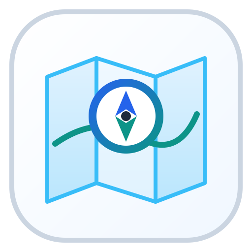
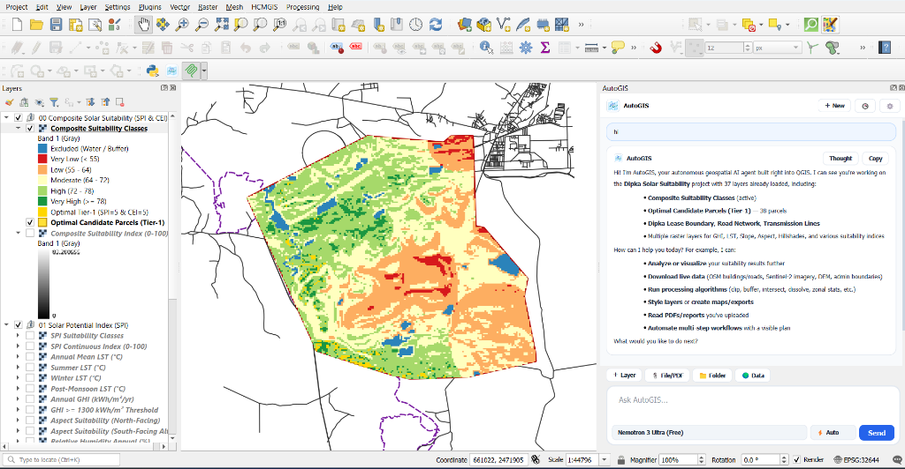

# AutoGIS Studio (`v1.0.0`)

**Autonomous Geospatial AI Agent & Spatial Analysis Studio for QGIS**

[-0284C7?style=for-the-badge&logo=qgis&logoColor=white)](https://github.com/sutharprin098/AutoGIS/releases/latest/download/AutoGIS.zip)

---

## AutoGIS Studio Live inside QGIS Desktop

  
  
<em>AutoGIS Studio v1.0.0 running live inside QGIS Desktop — automatically inspecting a 37-layer Multi-Criteria Solar Suitability project, auditing CRS alignment (EPSG:32644), and executing step-by-step spatial workflows.</em>

---

## Overview

**AutoGIS Studio (`v1.0.0`)** is an open-source **Autonomous Geospatial AI Agent** built natively for **QGIS Desktop**.

It connects your choice of frontier AI models (**Google Gemini, OpenAI ChatGPT, Anthropic Claude, DeepSeek, or OpenRouter**) directly to your live QGIS map canvas, Processing toolbox, real-time satellite/OSM spatial APIs, and local documents/PDFs — capable of handling everything from quick map styling to **30+ layer multi-step spatial modeling pipelines** without freezing or crashing QGIS.

### Core Engineering Highlights (`v1.0.0`)
- **Automatic CRS Intelligence (`EPSG` & Metric UTM Auto-Alignment):** Audits Project CRS vs. Layer CRS (`meters` vs. `degrees`), automatically reprojects geographic (`EPSG:4326`) layers into local metric UTM zones during buffer/distance operations, and aligns mismatched CRSs before running spatial overlays (`clip`, `intersection`, `difference`, `union`).
- **Smart Large-Task Decomposition (Phase-by-Phase Execution):** Automatically breaks complex, multi-layer GIS workflows into sequential steps (`update_agent_plan`), executing 1–2 tools per turn with non-blocking `35ms` Qt event-loop pacing so QGIS stays responsive.
- **Ultra-Low Token Consumption:** Uses compact single-line project state serialization and automatic history compaction (`_compact_messages_for_llm`), reducing prompt token consumption by up to 65% on large 35+ layer projects.
- **Zero-Setup Live Spatial Data Connectors:** Download administrative boundaries (**Nominatim/Photon**), live **OpenStreetMap** vectors (**Overpass API** with automatic mirror failover), **OSRM** road routes, and **Microsoft Planetary Computer STAC** Cloud-Optimized GeoTIFFs (`30m Copernicus DEM`, `10m Sentinel-2`, `10m Esri LULC`) directly into QGIS.
- **Universal Large PDF, GeoPDF & Folder Reader:** Attach 200+ page PDF reports, GeoPDF maps, `.docx`, `.xlsx`, `.csv`, `.geojson`, or entire project folders — with instant page pagination and full-document keyword search.
- **Unified 5-Provider Settings with `<2s` Connection Test:** Connect **Gemini**, **ChatGPT**, **Claude**, **DeepSeek**, or **OpenRouter** from a single clean dialog with a thread-safe `<2s` live connection test and synced model selection.

---

## 1-Click Download & Direct Install in QGIS (`Install from ZIP`)

You can install **AutoGIS Studio (`v1.0.0`)** directly inside QGIS in **under 30 seconds**:

### [Click Here to Download `AutoGIS.zip` (`v1.0.0`) Directly from GitHub Releases](https://github.com/sutharprin098/AutoGIS/releases/latest/download/AutoGIS.zip)
*(Official Documentation & Web Portal: [https://autogis.princesite.in/](https://autogis.princesite.in/) | Contact: [sutharprince098@gmail.com](mailto:sutharprince098@gmail.com))*

### Method 1: Install from ZIP in QGIS (Recommended)
1. Download **`AutoGIS.zip`** from the link above to your computer.
2. Open **QGIS Desktop**.
3. In the top menu bar, click **`Plugins`** -> **`Manage and Install Plugins...`**
4. In the left sidebar, click **`Install from ZIP`**.
5. Click **`...`** (Browse), select **`AutoGIS.zip`**, and click **`Install Plugin`**.
6. Click **`AutoGIS Studio`** in the QGIS toolbar (or press **`Ctrl+Shift+G`**) to launch the AI studio.

---

### Method 2: Add via QGIS Custom Plugin Repository URL
1. Open **QGIS** -> **`Plugins`** -> **`Manage and Install Plugins...`** -> **`Settings`** tab.
2. Under *Plugin Repositories*, click **`Add...`**
3. Enter:
   - **Name:** `AutoGIS Official Repository`
   - **URL:** `https://raw.githubusercontent.com/sutharprin098/AutoGIS/main/plugins.xml`
4. Click **OK**, switch to the **All** tab, search **`AutoGIS`**, and click **Install Plugin**.

---

### Method 3: Manual Plugin Folder Copy (Developer Mode)
Clone or copy the `AutoGIS` folder directly into your QGIS Python plugins directory:
- **Windows:** `%APPDATA%\QGIS\QGIS3\profiles\default\python\plugins\AutoGIS`
- **Linux:** `~/.local/share/QGIS/QGIS3/profiles/default/python/plugins/AutoGIS`
- **macOS:** `~/Library/Application Support/QGIS/QGIS3/profiles/default/python/plugins/AutoGIS`

---

## Quick AI Setup (Under 20 Seconds)

By default, **no AI provider or model is pre-selected** so you stay in full control of your API keys:

1. Click the **`Settings`** button in the top-right header of the **AutoGIS** panel.
2. **AI Provider:** Select **Google Gemini**, **OpenAI (ChatGPT)**, **Anthropic (Claude)**, **DeepSeek**, or **OpenRouter (All Models)**.
3. **API Key:** Paste your API key into the unified input box and click **`Test`** to verify in under 2 seconds.
4. **AI Model:** Select a model from the synced dropdown (or type any custom Model ID) and click **`Save`**.

---

## Complete Toolset (25 Autonomous GIS Tools)

| Category | Tools Included |
| :--- | :--- |
| **Live Earth & Spatial Data** | `fetch_place_boundary`, `fetch_osm_features`, `compute_road_route`, `fetch_stac_earth_data` (`dem`, `sentinel2`, `lulc`), `list_saved_qgis_connections`, `load_saved_qgis_connection` |
| **Large PDFs, Docs & Folders** | `read_uploaded_file_or_pdf` (PDF page pagination, full-PDF keyword search, GeoPDF canvas loader, DOCX/XLSX/CSV/folder reader) |
| **Project & Layer Inspection** | `update_agent_plan`, `get_project_overview` (with CRS audit), `list_layers`, `inspect_layer` (Vector + Raster Band Stats), `query_features`, `compute_field_stats`, `evaluate_expression`, `select_features` |
| **Layer Creation & Management** | `add_basemap`, `load_dataset`, `create_memory_layer`, `add_features`, `calculate_or_add_field`, `delete_features`, `manage_layer_tree`, `export_layer`, `save_project` |
| **Cartography & Symbology** | `style_vector_layer` (`single`, `categorized`, `graduated`, `heatmap`), `configure_labels`, `zoom_map`, `capture_map_canvas` |
| **Geoprocessing & PyQGIS** | `spatial_buffer` (auto-metric UTM CRS), `spatial_overlay` (`clip`, `intersection`, `difference`, `union`, `dissolve` with auto-CRS alignment), `search_processing_algorithms`, `get_algorithm_help`, `run_processing_algorithm`, `execute_pyqgis` |

---

## Google Earth Engine & resilient OSM access

AutoGIS can store a user's Google Earth Engine Cloud Project ID and optional
service-account configuration in the local QGIS profile. See
[Earth Engine and service configuration](docs/CONFIGURATION.md) for setup,
OAuth and service-account guidance. The credential JSON itself is not copied
into the repository or sent to the AutoGIS web portal.

OpenStreetMap feature downloads use bounded POST requests and a limited
Overpass mirror race with finite timeouts. Public Overpass servers are shared
community infrastructure, so very large or high-density requests may still be
throttled. Zoom into a smaller area or use a managed/self-hosted Overpass
instance for repeat production-scale extraction.

## License

Released under the **[MIT License](LICENSE)** — 100% original, clean-room open-source code.
