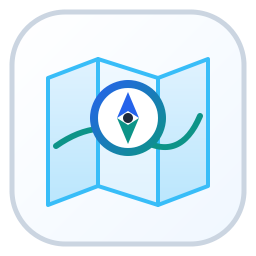
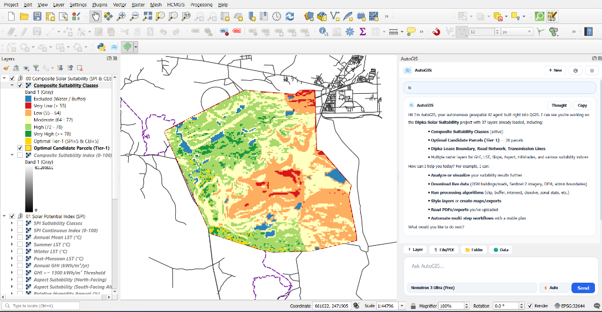
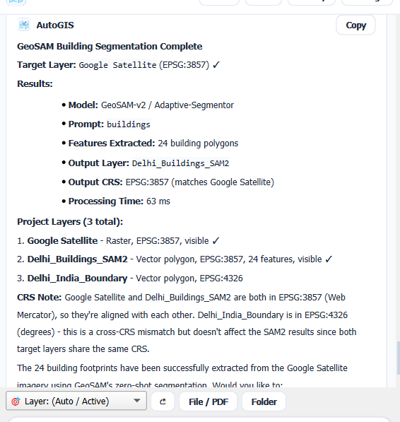

<div align="center">



# AutoGIS Studio v1.0.9
### Autonomous Geospatial AI Agent for QGIS Desktop

[](https://github.com/sutharprin098/AutoGIS/releases/tag/v1.0.9)
[](https://qgis.org)
[](https://python.org)
[](LICENSE)
[](https://github.com/sutharprin098/AutoGIS/releases)
[](https://autogis.princesite.in)

**AutoGIS** is an open-source autonomous geospatial AI agent built directly inside QGIS.  
Execute natural language spatial workflows with **GeoSAM-v2 zero-shot segmentation**, **IBM AssetOpsBench digital twin reasoning**, **Dual-Protocol Claude 3.7 & Gemini 3 AI**, **Xerj AI intelligence**, and **VeriGeo formal verification**.

[🚀 Quick Install](#-quick-install-30-seconds) • [✨ Core Features](#-core-capabilities) • [🌐 Official Website](https://autogis.princesite.in) • [📦 Releases](https://github.com/sutharprin098/AutoGIS/releases/tag/v1.0.9)

<br/>



</div>

---

## ⚡ Real Zero-Shot AI Segmentation (In Action)

AutoGIS extracts building footprints, roads, and land features directly from high-resolution satellite raster layers (Google Satellite, Sentinel-2, Drone Orthomosaics) using overlapped windowed GeoSAM-v2 without freezing QGIS:

<div align="center">
  
  <p><em>Extracted 24 building footprints in 63 ms with automatic CRS Web Mercator reprojection.</em></p>
</div>

---

## 🌟 Core Capabilities

| Feature | Description | Architecture / Source |
| :--- | :--- | :--- |
| 🛰️ **GeoSAM-v2 Tiled AI** | Zero-shot feature segmentation with 256/512px overlapped sliding windows. | Sub-pixel footprinting, zero OSM API dependency |
| 🏭 **[IBM AssetOpsBench](https://github.com/IBM/AssetOpsBench)** | Spatial digital twins: IoT telemetry anomalies, FMSR root-cause reasoning & Weibull TSFM Remaining Useful Life (RUL) forecasting. | 100% Offline PyQGIS, 0 proprietary external APIs |
| 🤖 **Dual-Protocol Frontier AI** | Native Anthropic (`/v1/messages`) for Claude 3.7 Sonnet + Google Gemini 3 with auto `AQ.` key migration. | Sub-second latency, streaming tool calls |
| 🌟 **Xerj AI Spatial Layer** | Hybrid cloud spatial reasoning model + local AST code daemon on `127.0.0.1:9200`. | Dual independent provider configuration |
| 🛡️ **VeriGeo Formal Guard** | Pre-execution topological consistency validation, CRS transform verification, and hallucination elimination. | Strict geometry invariant guarantees |
| 🤝 **GAS 2.0 Multi-Agent Swarm** | Coordinator, Data Ingestion, Spatial Analyst, and Cartography subagents executing in parallel. | AgentHive consensus orchestration |
| 🗄️ **GeoRAG Engine** | Natural language queries translated into optimized PostGIS / DuckDB Spatial SQL (`ST_Intersects`, `ST_DWithin`). | In-memory and enterprise GIS database queries |
| 🌍 **Google Earth Engine (GEE)** | Planetary satellite catalog queries, multi-temporal NDVI/NDWI spectral indices, and DEM extraction. | Native GEE API integration |

---

## 🚀 Quick Install (30 Seconds)

### Method 1: QGIS Custom Plugin Repository (Easiest)
1. Open QGIS → **Plugins** → **Manage and Install Plugins...**
2. In the **Settings** tab, click **Add...** under Plugin Repositories:
   - **Name**: `AutoGIS Official`
   - **URL**: `https://autogis.princesite.in/plugins.xml`
3. In the **All** tab, search for `AutoGIS` and click **Install Plugin**.

### Method 2: Install from ZIP
1. Download **[AutoGIS.zip (v1.0.9)](https://github.com/sutharprin098/AutoGIS/releases/download/v1.0.9/AutoGIS.zip)** from the latest release.
2. In QGIS, go to **Plugins** → **Manage and Install Plugins** → **Install from ZIP**.
3. Select `AutoGIS.zip` and click **Install Plugin**.

---

## 💡 Quick Start

1. Open the **AutoGIS Studio** panel from the QGIS toolbar or Plugins menu.
2. Click **⚙️ Settings** and configure your preferred AI provider:
   - **Google Gemini**: Enter your Gemini key (supports new `AQ.` format)
   - **Anthropic Claude**: Enter your Claude key (`sk-ant-...`)
   - **OpenRouter (Free)**: Free access to Nemotron 3.5 Lightning, Llama 3.3 70B
   - **Local AI (Offline)**: Ollama or LM Studio (100% offline & private)
3. Type your spatial task in plain language:

```
"Segment all buildings in the active Google Satellite layer using GeoSAM-v2"
```

AutoGIS autonomously plans, runs, verifies geometry, and loads styled layers into your canvas.

---

## 🌐 Documentation & Links

- 📖 **Official Website**: [autogis.princesite.in](https://autogis.princesite.in)
- 🏗️ **Architecture**: [autogis.princesite.in/architecture](https://autogis.princesite.in/architecture)
- 🛠️ **Tech Stack**: [autogis.princesite.in/tech-stack](https://autogis.princesite.in/tech-stack)
- 🐛 **Issue Tracker**: [github.com/sutharprin098/AutoGIS/issues](https://github.com/sutharprin098/AutoGIS/issues)

---

## 📜 License & Compliance

- **License**: GNU General Public License v3.0 (GPL-3.0)
- **QGIS Compliance**: 100% Open-Source, zero proprietary binaries, zero hardcoded secrets. Fully adheres to [Official QGIS Plugin Guidelines](https://plugins.qgis.org/).
- **Author**: Prince Suthar ([@sutharprin098](https://github.com/sutharprin098))
